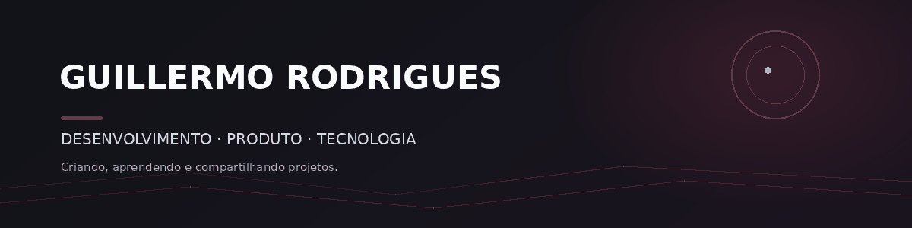

  

<h1 align="center">Olá, eu sou Guillermo 👋</h1>

  Desenvolvedor em formação, interessado em criar produtos digitais úteis e bem construídos.

  

---

### 👨‍💻 Sobre mim

- 🚀 Gosto de transformar ideias em projetos funcionais.
- 🧩 Tenho interesse em desenvolvimento web, automação e experiência do usuário.
- 📚 Estou sempre aprendendo e aprimorando meus projetos.
- 🇧🇷 Brasil

### ✨ No que estou focado

Atualmente estou construindo e explorando projetos próprios. Quero compartilhar por aqui o que estou aprendendo, as decisões que tomo e os resultados que desenvolvo.

### 🛠️ Ferramentas

TypeScript · JavaScript · React · Next.js · Tailwind CSS · Node.js · Git

### 📌 Projetos em destaque

> Adicione aqui os projetos que deseja tornar públicos. Você pode incluir uma descrição curta e um link para cada repositório público.

- **Nome do projeto** — uma frase explicando o que ele faz. [Ver projeto](LINK_DO_REPOSITORIO)
- **Nome do projeto** — uma frase explicando o que ele faz. [Ver projeto](LINK_DO_REPOSITORIO)

### 🤝 Contato

- LinkedIn: ADICIONE_SEU_LINK
- Portfólio: ADICIONE_SEU_LINK
- E-mail profissional: ADICIONE_SEU_CONTATO

---

  Feito com curiosidade, café e commits ☕

